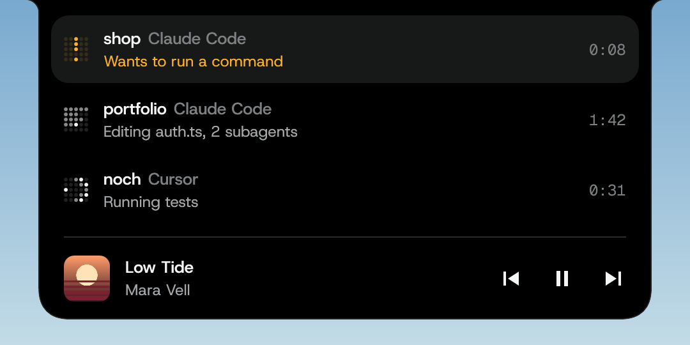
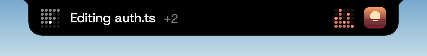
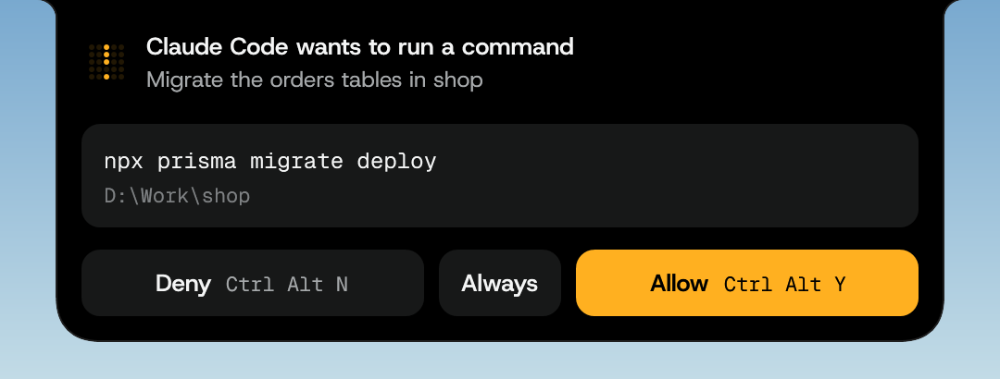
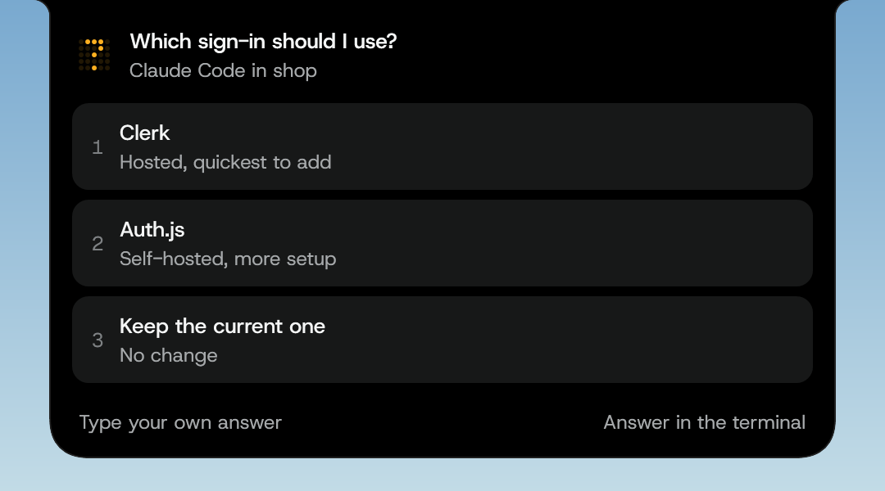

# Noch

A notch for Windows that shows what your AI agents are doing and what is playing.

It hangs off the top edge of the screen. Most of the time it is a thin black lip. It grows when an agent starts working or a track plays, and drops open only when an agent is waiting on you. Amber always means "you need to act".

<p align="center"></p>

## Install

1. Download **Noch-win-Setup.exe** from the [latest release](../../releases/latest).
2. Open it. There is no wizard and it needs no admin rights. It takes a few seconds.
3. Noch drops down from the top of the screen. Press **Connect** next to Claude Code or Cursor.

Agent sessions that were already open need to be restarted once.

Windows may say "Windows protected your PC", because the installer is not code-signed yet. Choose **More info**, then **Run anyway**.

Works on Windows 10 (1809 or later) and Windows 11, 64-bit. Noch checks for updates by itself. To remove it, use Settings > Apps. Uninstalling also takes its hooks back out of your agents' settings.

## What it does

| | |
|---|---|
|  | **At a glance.** What the busiest agent is doing, and the current track. |
|  | **Approvals.** See the whole command and answer with a click, or `Ctrl Alt Y` and `Ctrl Alt N`. |
|  | **Questions.** Pick an option or type your own answer. |
|  | **Now playing.** Spotify, YouTube in a browser, or anything else Windows knows about. |

**It stays out of the way.** Over a maximised window it shrinks to a thin strip that clicks pass through, so your tabs stay usable. Rest the pointer against the top edge to open it. In fullscreen it hides. It never takes keyboard focus unless you choose to type an answer, and its buttons ignore clicks for the first 0.4 seconds so nothing is approved by accident.

### Supported agents

| Agent | Shows activity | Approve and answer |
|---|---|---|
| Claude Code | Yes | Yes |
| Cursor | Yes, new and lightly tested | No, it only watches |

## How it works

Agents report through their own hooks. **Connect** adds entries to `~/.claude/settings.json` (or `~/.cursor/hooks.json`) that run a tiny helper, `noch-hook.exe`. A copy of the original file is kept next to it as `.before-noch`, and everything else in the file is left alone.

The helper talks to Noch over a Windows pipe that only your own user account can open. Nothing leaves your PC except the update check against GitHub. If Noch is closed, the helper exits silently and your agent carries on as normal.

Music comes from the media session Windows already keeps. The dots follow the speaker level only. Noch never records or listens to sound.

## Build it yourself

Needs the .NET SDK, version 8 or later.

```powershell
dotnet test
dotnet run --project src/Noch
```

| Folder | What is in it |
|---|---|
| `src/Noch.Core` | Agent state, the pipe server, editing agent settings. No UI. |
| `src/Noch.Hook` | The helper that agents run. |
| `src/Noch` | The notch itself (WPF), media, tray icon, updates. |
| `tests/Noch.Tests` | Tests, including the real helper talking to a real server. |

To publish a release, push a tag such as `v0.1.0`. GitHub Actions builds the installer and attaches it.

## Licence

MIT. Host Grotesk and Geist Mono are included under the SIL Open Font License (see `src/Noch/Fonts`).
