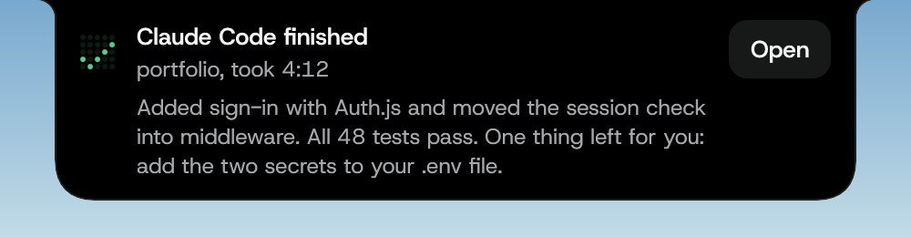
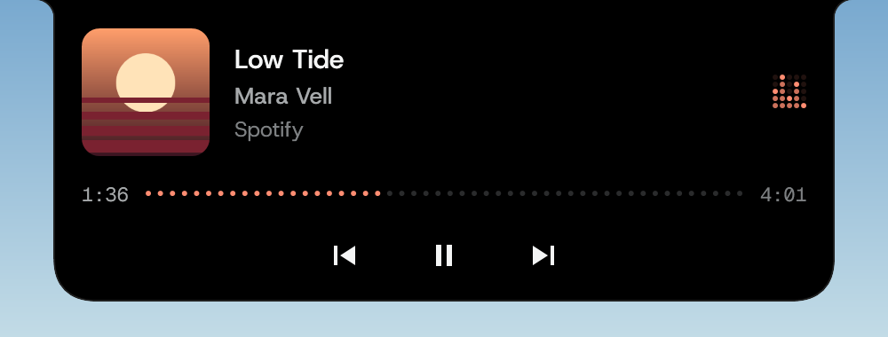
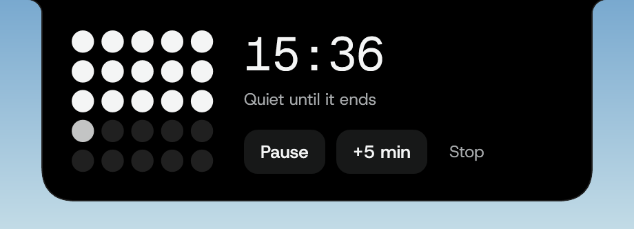
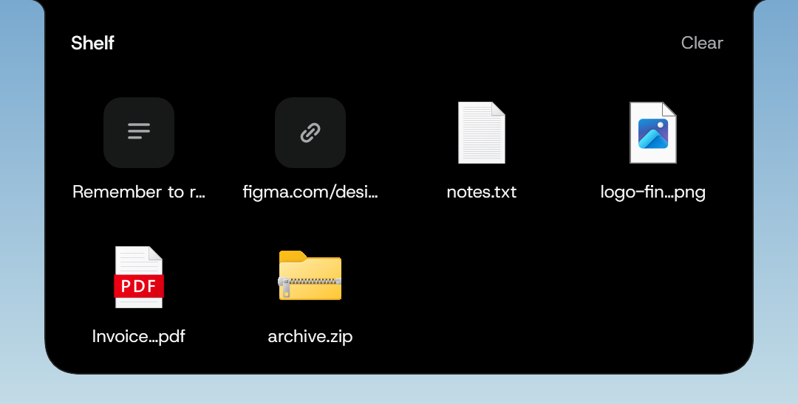
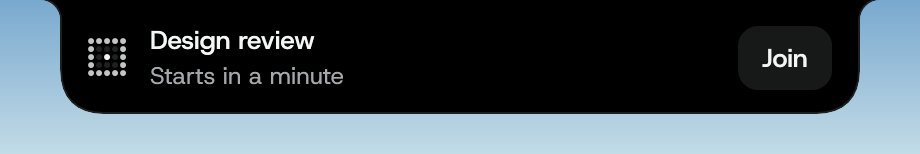
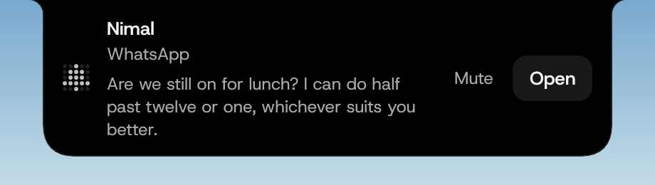

# Noch

A notch for Windows that shows what your AI agents are doing, what is playing, and what is next.

It hangs off the top edge of the screen, or any other edge or corner you drag it to. Most of the time it is a thin black lip. It grows when an agent starts working or a track plays, and drops open only when an agent is waiting on you. Amber always means "you need to act".

<p align="center"></p>

## Install

1. Download **Noch-win-Setup.exe** from the [latest release](../../releases/latest).
2. Open it. There is no wizard and it needs no admin rights. It takes a few seconds.
3. Noch drops down from the top of the screen. Press **Connect** next to Claude Code or Cursor.

Agent sessions that were already open need to be restarted once.

Windows may say "Windows protected your PC", because the installer is not code-signed yet. Choose **More info**, then **Run anyway**.

Works on Windows 10 (1809 or later) and Windows 11, 64-bit. Noch checks for updates by itself. To remove it, use Settings > Apps. Uninstalling also takes its hooks back out of your agents' settings.

## What it does

| | |
|---|---|
|  | **At a glance.** What the busiest agent is doing, and the current track. |
|  | **Approvals.** See the whole command and answer with a click, or `Ctrl Alt Y` and `Ctrl Alt N`. |
|  | **Questions.** Pick an option or type your own answer. |
|  | **Finished.** What the agent said when it was done, with a soft sound. A warning if two agents edit the same file. |
|  | **Now playing.** Spotify, YouTube in a browser, or anything else Windows knows about. Scroll over it to change the volume. |
|  | **Focus timer.** Twenty-five dots that go out one by one. While it runs, only what needs you gets through. |
|  | **Shelf.** Drag files, links or text onto the notch and drag them out again later. It remembers where they are and never moves or copies them. |
|  | **Meetings.** A countdown from ten minutes before, then a Join button. Needs your calendar's private iCal link. |
|  | **Other apps' notifications.** Off until you turn it on. Mute any app with a click. |

Open it from anywhere with `Ctrl Alt .`, and find everything else in **Settings**, from the gear in the notch or the tray icon.

**It stays out of the way.** Over a maximised window it shrinks to a thin strip that clicks pass through, so your tabs stay usable. Rest the pointer against the top edge to open it. In fullscreen it hides. It never takes keyboard focus unless you choose to type an answer, and its buttons ignore clicks for the first 0.4 seconds so nothing is approved by accident.

**Put it anywhere.** Drag it off the edge and it stretches, snaps free into a bubble, and settles on whichever edge or corner you drop it near. On the left and right edges the bar stands upright. With more than one screen, carry it over to another screen and drop it there. It remembers its place. If that screen is unplugged it waits on the main screen and goes back when the screen returns. **Move back to the top of the main screen** in the tray menu brings it home.

### Supported agents

| Agent | Shows activity | Approve and answer |
|---|---|---|
| Claude Code | Yes | Yes |
| Codex | Yes, not yet tested with a real session | Yes, not yet tested with a real session |
| Cursor | Yes, lightly tested | No, it only watches |

Each agent shows how large its conversation has grown. **Usage limits** (how much of a Claude plan is used) can be turned on in Settings, but Claude Code only shares that in a terminal, not in its desktop app.

## How it works

Agents report through their own hooks. **Connect** adds entries to `~/.claude/settings.json` (or `~/.cursor/hooks.json`) that run a tiny helper, `noch-hook.exe`. A copy of the original file is kept next to it as `.before-noch`, and everything else in the file is left alone.

The helper talks to Noch over a Windows pipe that only your own user account can open. Nothing leaves your PC except the update check against GitHub and, if you add one, fetching your calendar. The calendar link is stored encrypted. Notifications are shown and forgotten. If Noch is closed, the helper exits silently and your agent carries on as normal.

Conversation sizes come from the token counts in Claude's own log files; only the counts are used. The daily tally stays on this PC. Music comes from the media session Windows already keeps. The dots follow the speaker level only. Noch never records or listens to sound.

## Build it yourself

Needs the .NET SDK, version 8 or later.

```powershell
dotnet test
dotnet run --project src/Noch
```

| Folder | What is in it |
|---|---|
| `src/Noch.Core` | Agent state, the pipe server, editing agent settings. No UI. |
| `src/Noch.Hook` | The helper that agents run. |
| `src/Noch` | The notch itself (WPF), media, tray icon, updates. |
| `tests/Noch.Tests` | Tests, including the real helper talking to a real server. |

To publish a release, push a tag such as `v0.1.0`. GitHub Actions builds the installer and attaches it.

## Licence

MIT. Host Grotesk and Geist Mono are included under the SIL Open Font License (see `src/Noch/Fonts`).
